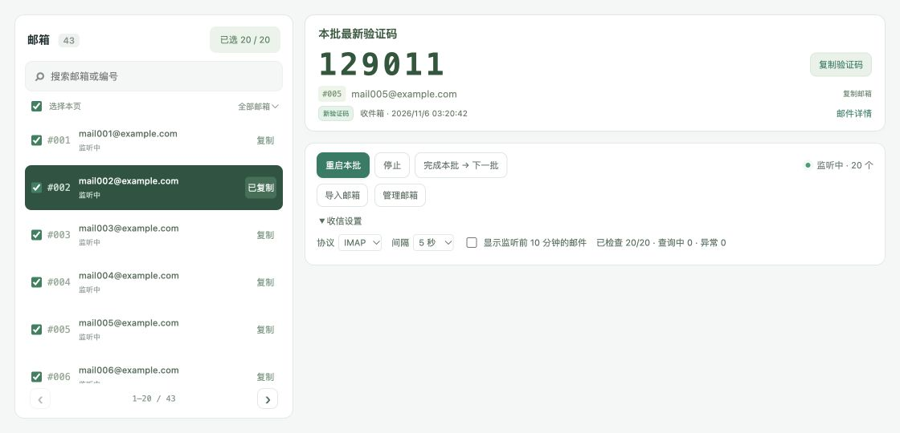
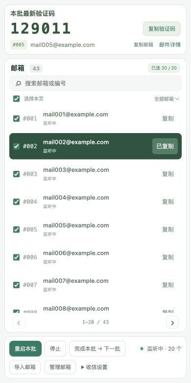

<div align="center">


# Receive Mail Tool

### 收码台 · Hotmail / Outlook 邮箱验证码工作台

批量导入已授权的 Hotmail / Outlook.com 邮箱。<br />
按批查收邮件，在同一个页面查看、核对和复制最新验证码。

[](https://www.python.org/downloads/)
[](#邮箱授权)
[](#本机数据)
[](LICENSE)

[**下载 Windows x64 免安装版**](https://github.com/qianyubtc/Receive-Mail-Tool/releases/latest/download/Receive-Mail-Tool-Windows-x64.zip)

[功能介绍](#功能介绍) · [快速开始](#快速开始) · [邮箱授权](#邮箱授权) · [常见问题](#常见问题) · [构建与验证](#构建与验证)

</div>

<p align="center">
  &nbsp;
</p>

<p align="center"><sub>桌面与 H5 预览。图中的邮箱、邮件和验证码均为模拟数据。</sub></p>

## 功能介绍

| 功能 | 说明 |
| --- | --- |
| 批量导入 | 从 TXT 或剪贴板导入邮箱，自动编号，支持按编号或地址搜索。 |
| 分批监听 | 每批最多 20 个邮箱。完成一批后标记为已用，并选中下一批未用邮箱。 |
| 验证码提取 | 检查收件箱和垃圾箱，按邮件送达时间显示本批最新一条验证码。可打开邮件正文核对。 |
| 一键复制 | 复制邮箱地址或验证码。列表会高亮最近复制的邮箱。 |
| 本地管理 | 查看单个邮箱的近期邮件，按使用状态筛选，从回收站恢复或彻底移除本地记录。 |

## 快速开始

### Windows 免安装版

下载 [Windows x64 免安装包](https://github.com/qianyubtc/Receive-Mail-Tool/releases/latest/download/Receive-Mail-Tool-Windows-x64.zip)，完整解压后双击 `MailCode/启动收码工具.bat`。适用于 Windows 10 / 11 x64，已内置 Python。

### 从源码运行

安装 [Python 3.9 或更高版本](https://www.python.org/downloads/)。程序只使用 Python 标准库。可以从仓库的 **Code → Download ZIP** 下载并解压源码，也可以克隆仓库。

```sh
git clone https://github.com/qianyubtc/Receive-Mail-Tool.git
cd Receive-Mail-Tool
```

| 平台 | 启动 |
| --- | --- |
| Windows | 双击 `启动收码工具.bat`，或运行 `py -3 mailtool.py --open`。也可以[构建内置 Python 的免安装包](#构建与验证)。 |
| macOS / Linux | 运行 `python3 mailtool.py --open`。macOS 也可双击 `启动收码工具.command`。 |

页面默认打开在 [127.0.0.1:8765](http://127.0.0.1:8765)。保留终端窗口即可在后台收信。端口被占用时，可以在启动命令末尾加 `--port 8766`。

### 查收第一批验证码

1. 点击 **导入邮箱**，粘贴账号信息或选择 TXT 文件。一行对应一个邮箱。
2. 在列表勾选本批邮箱，点击 **开始监听**。通过 **收信设置** 可选择 Graph 或 IMAP。
3. 在 **本批最新验证码** 查看结果。点击 **复制验证码**，或打开 **邮件详情** 核对原文。
4. 点击 **完成本批 → 下一批**，标记本批已用并选择下一批。如果监听正在运行，工具会接着监听下一批。

## 邮箱授权

支持本人拥有或获授权管理的 Hotmail 和 Outlook.com 个人邮箱。导入时需要配对的 OAuth 应用 `client_id` 和邮箱 `refresh_token`。四段之间使用 `----` 分隔。

```text
demo@example.com----unused----YOUR_CLIENT_ID----YOUR_REFRESH_TOKEN
```

第二段是兼容字段，可以留空。程序使用 OAuth 查收邮件，密码字段在导入后丢弃。示例值仅作占位。

| 协议 | 授权要求 |
| --- | --- |
| Microsoft Graph | 默认协议。应用需要允许读取邮件正文的委派权限，例如 `Mail.Read`。参见 [Microsoft Graph 邮件权限](https://learn.microsoft.com/en-us/graph/api/user-list-messages?view=graph-rest-1.0#permissions)。 |
| IMAP | 邮箱需启用 IMAP，并授权 Outlook 的 `IMAP.AccessAsUser.All`。参见 [Microsoft IMAP OAuth 指南](https://learn.microsoft.com/en-us/exchange/client-developer/legacy-protocols/how-to-authenticate-an-imap-pop-smtp-application-by-using-oauth)。 |

申请刷新令牌时应包含 `offline_access`。授权失效后，重新获取令牌并导入同一个邮箱即可更新凭据。

## 常见问题

| 情况 | 处理 |
| --- | --- |
| 查收有延迟 | 在 **收信设置** 将默认 10 秒改为 5 秒，再点击 **重启本批**。间隔按每个邮箱完成查询后计算，网络、队列和微软限流都会影响实际耗时。 |
| 邮件在监听前已收到 | 在 **收信设置** 勾选 **显示监听前 10 分钟的邮件**，或从邮箱详情查看近期邮件。 |
| 邮件已到，验证码没显示 | 打开邮箱详情核对正文。自动识别覆盖常见数字和字母数字格式，部分格式需要人工核对。 |
| 切换标签页后还会查收吗 | 会。监听由本机后台服务执行，直到点击 **停止** 或关闭服务。 |

浏览器会记住上次成功启动监听时选择的协议和间隔。微软返回限流指令时，程序会按服务端要求推迟重试。

## 本机数据

网页默认仅允许本机访问，收信请求直接发送给微软。程序以只读方式查收，邮箱管理操作只影响本地数据。

账号、刷新令牌、邮件缓存和邮箱状态保存在 `.mailtool/accounts.sqlite3`。数据库未加密，请勿上传或分享 `.mailtool`。升级时先关闭工具，再将旧版的 `.mailtool` 复制到新版程序目录。

<details>
<summary>Windows 局域网只读诊断</summary>

通过 `启动局域网诊断.bat` 可临时开启诊断服务。默认端口为 8767，读取日志需要启动时生成的访问码。日志记录操作阶段、耗时和错误类别，排除邮箱地址、令牌、验证码和邮件内容。

</details>

## 构建与验证

### Windows 免安装包

```sh
python3 scripts/build_windows.py
```

Windows 上可将 `python3` 替换为 `py -3`。构建脚本会下载 Python 官方 Windows x64 嵌入式运行时，验证 SHA-256 后生成 `dist/收码台-Windows-简洁版-x64.zip`。在 Windows 10 / 11 x64 上完整解压后，双击 `启动收码工具.bat` 即可使用内置 Python。详见 [Windows 使用说明](Windows使用说明.txt)。

### 开发检查

```sh
python3 -m unittest discover -s tests -v
node --check web/app.js
```

Python 测试使用模拟邮箱和临时数据库，覆盖验证码提取、批次切换、令牌刷新和诊断脱敏。Node.js 用于检查前端脚本语法。

## 项目缘起

芊羽最初从小布微软邮箱批发购买了一批 Hotmail 邮箱。收码台就是为集中查收这批邮箱的验证码而做的，最早的导入格式也来自该服务商的四段式账号信息。[查看 Hotmail 商品页](https://wuemail.cn/item/120)

## 许可证

项目源码采用 [MIT 许可证](LICENSE)。Windows 免安装包内的 Python 运行时许可见 `runtime/LICENSE.txt`。
